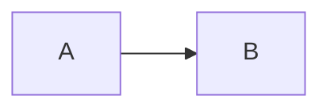
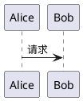

# MDView

一个面向 Windows 的 Markdown 编辑器 / 阅读器：**编辑与预览实时同步**，原生支持 **Mermaid**、**PlantUML** 图表与 **KaTeX（LaTeX 子集）公式**，可 **一键打印**，并 **导出 Word / PDF / HTML**。

基于 Electron + Chromium，导出 PDF 走 Chromium 打印引擎，排版与预览所见即所得。

---

## 功能

### 渲染
- **Markdown / GFM**：表格、任务列表、脚注、定义列表、删除线、上下标（`H~2~O`、`x^2^`）、缩写、高亮（`==文字==`）、下划线（`++文字++`）、表情符号
- **数学公式 KaTeX**：行内 `$…$` 或 `\(…\)`，块级 `$$…$$` 或 `\[…\]`；支持矩阵、分段函数、多行对齐等
- **Mermaid**（本地 JS 渲染，离线可用）：流程图、时序图、类图、状态图、ER 图、甘特图、饼图、Git 分支图、思维导图、时间线
- **PlantUML**：默认走远程服务，也可配置 **本地 Java + plantuml.jar 离线渲染**
- **代码高亮**：highlight.js，内置 20 套主题（GitHub / Atom / Monokai / Dracula / VS / Xcode…）
- **自动目录**：写 `[TOC]` 即可生成带层级与锚点的目录
- **提示框**：`> [!NOTE]` / `[!TIP]` / `[!IMPORTANT]` / `[!WARNING]` / `[!CAUTION]`
- 标题锚点、外链点击、本地图片路径自动解析（相对路径 / Windows 绝对路径均可）

### 编辑体验
- CodeMirror 6 编辑器：Markdown 语法高亮、行号、代码折叠、括号匹配、多光标、查找替换（支持正则）
- 工具栏 + 菜单，覆盖标题、加粗斜体、列表、引用、代码块、表格、链接图片、公式、图表、目录、分页符
- 编辑区 / 预览区 / 分栏三种模式，分栏宽度可拖动
- **滚动同步**（双向）、大纲侧栏（点击跳转）
- 预览区直接勾选任务列表复选框，会**回写源码**
- 浅色 / 深色主题，缩放，拼写检查（可选）
- 草稿自动保存，意外关闭不丢内容；关闭前提示保存

### 导出与打印
| 目标 | 说明 |
| --- | --- |
| **HTML** | 单文件自包含：CSS 内联、KaTeX 字体内联为 base64、图表内联为 SVG、本地图片转 base64。离线可看 |
| **PDF** | Chromium 打印引擎，可选纸张（A4/A3/A5/Letter/Legal/Tabloid）、页边距、横向、页码、背景色 |
| **Word (.docx)** | 标题 / 列表 / 表格 / 引用 / 脚注全部转为原生 Word 结构；代码块渲染成带底纹、内边距、语言标题栏的「代码框」；**公式与图表栅格化后以图片嵌入**，保证 Word 里也是所见即所得 |
| **打印** | `Ctrl+P` 打开打印预览窗口；菜单「一键打印」直接把渲染结果交给系统打印机 |

---

## 环境要求

- Windows 10 / 11（x64）
- Node.js ≥ 18（开发与打包）
- 可选：Java 8+（仅本地渲染 PlantUML 时需要，不装则用远程服务）

## 快速开始

```bash
npm install

# 构建三方资源 + 打包前端，然后启动
npm start
```

后续再次启动（资源未变动）：

```bash
npm run dev
```

### 国内网络安装

仓库根目录自带 `.npmrc`，默认走 npmmirror 镜像，无需额外配置：

```ini
registry=https://registry.npmmirror.com
electron_mirror=https://npmmirror.com/mirrors/electron/
electron_builder_binaries_mirror=https://npmmirror.com/mirrors/electron-builder-binaries/
```

几个容易踩的坑：

| 现象 | 原因 | 处理 |
| --- | --- | --- |
| `'electron-builder' 不是内部或外部命令`、`Cannot find module 'electron'` | `package.json` 的 `devDependencies` 没声明它们，`npm install` 会把不在清单里的包当多余依赖清掉 | 确认 `devDependencies` 含 `electron` / `electron-builder` / `esbuild`，再执行 `npm install` |
| `Cannot find module './stringUtil'`（来自 `builder-util`）等残包报错 | 上一次 `npm install` 被中断，包只解压了一半 | 重跑 `npm install`；仍不行就删掉 `node_modules` 后完整重装 |
| `node_modules/electron/dist/electron.exe` 不存在（应用起不来） | Electron 运行时二进制的 postinstall 没执行或下载失败 | 单独补装：`node node_modules/electron/install.js`（需先设好 `ELECTRON_MIRROR`） |
| 打包时卡在下载 nsis / winCodeSign | electron-builder 的辅助二进制默认走 GitHub | 已由 `.npmrc` 的 `electron_builder_binaries_mirror` 接管 |

## 打包 Windows 应用

```bash
# 生成免安装目录（release/win-unpacked）
npm run pack

# 生成安装包 + 免安装单文件 exe
npm run dist
```

产物输出到 `release/`：
- `MDView Setup x.y.z.exe`（NSIS 安装包，可自选安装目录、创建快捷方式）
- `MDView-x.y.z-portable.exe`（免安装版）

两点默认行为：

- **复用本地 Electron**：`build.electronDist` 指向 `node_modules/electron/dist`，打包时不再联网下载 100 MB 的 Electron 发行包。这既能避开镜像偶发 502，也能省下一两分钟。若要改回官方下载，删掉该字段即可。
- **不打包 node_modules**：渲染层与主进程都已由 esbuild 打成自包含的 `dist/renderer.js` / `dist/main.js`，运行时只依赖 Node 内置模块与 `electron`，`vendor/` 里的三方资源随包带上。`build.files` 因此显式排除 `node_modules`，asar 从 208 MB 降到约 11 MB。

### 打包报 `EBUSY: resource busy or locked, unlink ...app.asar`

这不是"等一会儿再跑"能解决的问题：`release/win-unpacked/resources/app.asar` 正被某个进程持有（杀毒软件扫描、Windows 索引服务，或从该目录启动过的 MDView）。可以用 PowerShell 直接验证锁是否还在：

```powershell
Rename-Item "release\win-unpacked\resources\app.asar" "app.asar.probe"
```

如果报「另一个进程正在使用此文件」，就是持续占用，延迟无效。

`npm run dist` 现在走 `scripts/dist.js`，遇到这种情况依次尝试：

1. 带线性退避**重试删除**（杀软扫描通常几百毫秒就松手）；
2. 仍失败则把旧目录**改名搁置** —— 目录改名是一次元数据操作，比逐文件 unlink 容易通过；
3. 都失败则自动换到 `release/build-<时间戳>/` 输出，保证包一定能打出来。

想恢复成 `release/` 直出，先退出正在运行的 MDView，再删掉 `release/` 下的 `win-unpacked`、`win-unpacked.tmp`、`build-*` 残留目录。

## 命令行导出

不开界面，直接把 Markdown 导出成 HTML / PDF / Word（公式、图表、思维导图都会真实渲染）：

```bash
# 开发态
npm run cli -- report.md --to pdf
npm run cli -- report.md --to pdf,docx,html -o dist/

# 打包后
MDView.exe --export report.md --to pdf,docx -o dist/
```

| 选项 | 说明 |
| --- | --- |
| `--to, --format <列表>` | `html` / `pdf` / `docx`，逗号分隔，默认 `html` |
| `-o, --out <路径>` | 输出文件；多格式时视为目录 |
| `--page <尺寸>` | PDF 纸张：A4 / A3 / A5 / Letter / Legal / Tabloid |
| `--margin <mm>` | PDF 页边距，默认 18 |
| `--landscape` | PDF 横向 |
| `--no-header-footer` | PDF 不显示页眉页脚 |

不带 `-o` 时输出到源文件同目录。退出码：0 成功、1 导出失败、2 参数错误。

## 可用脚本

| 命令 | 作用 |
| --- | --- |
| `npm run vendor` | 把 KaTeX / Mermaid / highlight.js 主题等三方资源复制到 `vendor/` |
| `npm run bundle` | 用 esbuild 打包渲染进程、主进程、highlight.js 浏览器包 |
| `npm run icon` | 生成 `build/icon.ico`（纯代码生成，无第三方依赖） |
| `npm run build:assets` | 上面三步的合集 |
| `npm start` | 构建资源并启动应用 |
| `npm run dev` | 不重新构建，直接启动（要求已构建过） |
| `npm run cli` | 无界面导出（见上一节） |
| `npm run pack` / `npm run dist` | 打包（走 `scripts/dist.js`：清理重试 + 被占用时改名/换目录兜底） |
| `npm test` | 跑离线测试（渲染管线 + Word 导出结构 + 栅格化 SVG 合法性），不需要图形界面 |
| `npm run sample` | 用真实管线把 `test/sample.md` 导出成 `.tmp/sample.html`，方便离线核对排版 |

## 测试

### 离线测试（推荐先跑这个）

```bash
npm test
```

不需要启动图形界面，直接验证三件事：

1. **渲染管线**：公式抽取数量、KaTeX 是否真的渲染、占位符是否残留、目录是否展开、图表占位是否正确；
2. **Word 导出结构**：把 token 树真正打包成 `.docx`，再拆开 `word/document.xml` 逐项校验 —— 公式是否都变成图片、代码块是否有底纹 / 内边距 / 语言标题栏 / 保留缩进、制表符是否已展开、相邻代码框有没有被 Word 合并；
3. **栅格化 SVG 合法性**：对含 `&`、`<`、`>、br` 的公式用真实 XML 解析器校验 `<foreignObject>` SVG 是否合法（非法会导致公式在 Word 里整批消失）。

结果同时写入 `_offline.txt` / `_raster.txt`，产物在 `.tmp/offline.docx`，可以直接打开看排版。

### 冒烟测试（需要图形界面）

启动真实窗口，自动渲染一份覆盖全部语法的文档，并校验三种导出产物的文件头与体积：

```bash
# PowerShell
$env:MDVIEW_SMOKE=1; npx electron .
```

输出会逐项列出渲染与导出结果，退出码 0 表示全部通过。
由于 Windows 上 Electron 属于 GUI 子系统进程，stdout 有时不可见，结果会**同时写入 `test/smoke-result.txt`**，直接看这个文件即可。

## 快捷键

| 快捷键 | 功能 |
| --- | --- |
| `Ctrl+N` / `Ctrl+O` / `Ctrl+S` / `Ctrl+Shift+S` | 新建 / 打开 / 保存 / 另存为 |
| `Ctrl+Shift+W` / `Ctrl+Shift+E` / `Ctrl+Shift+H` | 导出 Word / PDF / HTML |
| `Ctrl+P` / `Ctrl+Alt+P` | 打印预览 / 一键打印 |
| `Ctrl+F` | 查找替换 |
| `Ctrl+B` / `Ctrl+I` | 加粗 / 斜体 |
| `Ctrl+1..3` / `Ctrl+0` | 标题 1–3 / 正文 |
| `Ctrl+T` | 插入表格 |
| `Ctrl+K` / `Ctrl+Shift+I` | 插入链接 / 图片 |
| `Ctrl+M` / `Ctrl+Shift+M` | 插入行内公式 / 块级公式 |
| `Ctrl+Alt+1 / 2 / 3` | 编辑+预览 / 仅编辑 / 仅预览 |
| `Ctrl+Shift+O` | 显示 / 隐藏大纲 |
| `Ctrl+=` / `Ctrl+-` / `Ctrl+Shift+0` | 放大 / 缩小 / 实际大小 |
| `Ctrl+,` | 设置 |

## 语法速查

### 公式

```markdown
行内：$E = mc^2$ 或 \(E = mc^2\)

块级：
$$
\int_{-\infty}^{\infty} e^{-x^2}\,dx = \sqrt{\pi}
$$
```

常用片段：`\frac{a}{b}` `\sqrt[3]{x}` `\sum_{i=1}^{n}` `\int_{a}^{b}` `\lim_{x \to 0}` `\alpha \beta \gamma` `\begin{pmatrix}…\end{pmatrix}` `\begin{cases}…\end{cases}` `\begin{aligned}…\end{aligned}` `\text{中文}`

> 如果文档里有 `$100` 这种货币写法，可在设置里关闭「识别单美元符号行内公式」，改用 `\(…\)`。

### 图表

Mermaid 支持两种写法：`mermaid` 代码块内首行写图类型，或直接把图类型当语言标记（`mindmap`、`flowchart`、`sequenceDiagram`、`gantt` …）。后者代码块的语言标签会如实显示成具体图类型。

````markdown

````

````markdown
```mindmap
mindmap
    root((知识体系))
        AI 基础
            Transformer / Attention
            RAG 检索增强
        Agent
            ReAct、Plan & Execute
            工具调用、状态机
```
````

> 思维导图的层级完全由缩进表达，统一用 4 空格、不要混用 TAB。
> 节点文本避免半角括号（如 `PostgreSQL(向量扩展)`），Mermaid 会把它当成节点形状语法；
> 改用全角括号 `（）` 即可。语言标记写成 `mindmap` 时，首行的 `mindmap` 关键字可以省略，会自动补上。

````markdown

````

### 打印分页

```markdown
\pagebreak
```

---

## 项目结构

```
mdview/
├─ src/
│  ├─ main/                    # 主进程
│  │  ├─ main.js               # 窗口、菜单、IPC
│  │  ├─ paths.js              # 资源路径解析
│  │  ├─ store.js              # 设置持久化（userData/settings.json）
│  │  ├─ plantuml.js           # 本地 Java / 远程服务渲染 PlantUML
│  │  └─ exporter/
│  │     ├─ assets.js          # 单文件 HTML 组装、CSS/字体/图片内联
│  │     ├─ print.js           # PDF 导出、打印预览、直接打印
│  │     └─ docx.js            # Markdown token 树 → DOCX
│  ├─ preload/preload.js       # contextBridge 安全桥
│  └─ renderer/                # 渲染进程
│     ├─ index.html
│     ├─ styles/               # app.css / preview.css / print.css
│     └─ js/
│        ├─ app.js             # 应用主逻辑
│        ├─ editor.js          # CodeMirror 6 封装
│        ├─ util.js
│        └─ render/
│           ├─ markdown.js     # markdown-it 管线 + 公式抽取
│           ├─ diagrams.js     # Mermaid / PlantUML
│           └─ raster.js       # SVG / HTML → PNG（导出 Word 用）
├─ scripts/                    # vendor / bundle / make-icon
├─ test/
│  ├─ offline.js              # 离线测试：渲染管线 + Word 导出结构
│  ├─ raster.js               # 离线测试：栅格化 SVG 的 XML 合法性
│  ├─ smoke.js                # 冒烟测试（需图形界面）
│  └─ sample.md               # 覆盖全部语法的示例文档
├─ .tmp/                       # 测试产物（已 gitignore）
├─ vendor/                     # 构建产物：三方浏览器资源（已 gitignore）
└─ dist/                       # 构建产物：打包后的 JS（已 gitignore）
```

## 实现要点

**公式不被 Markdown 吞掉。** `_` `^` `\` 在 Markdown 里有语法含义，直接渲染会破坏 LaTeX。所以在交给 markdown-it 之前，先按字符扫描全文把公式抽成 `\uE000M0\uE001` 这样的占位符（会跳过围栏代码块与反引号行内代码），渲染完成后按索引还原成 KaTeX 的 HTML。

> ⚠️ 这个扫描器内部维护着「当前是否在围栏代码块里」的状态机。**围栏分隔行必须整行跳过**：如果让那行反引号继续走后面的「行内代码」分支，闭合栅栏会和下一段代码块的起始栅栏一起被吞掉，状态机整体错位，文档后半段会被误判成代码块 —— 结果是其中的 `$…$` 全部不被抽取，Word 里也就没有公式。`test/offline.js` 里有针对这一条的断言。

**Word 里的公式是真图片。** 导出 Word 时，渲染进程把每个公式的 KaTeX DOM 通过 `<svg><foreignObject>` + Canvas 栅格化成 PNG（KaTeX CSS 与 woff2 字体在构建期就内联成 base64，所以栅格化结果与屏幕一致），Mermaid / PlantUML 图则直接由 SVG 转 PNG，最后交给主进程用 `docx` 生成 `.docx` 并内嵌这些图片。

这套 SVG 由 DOM + `XMLSerializer` 序列化生成，**不允许手工拼字符串**：手工拼接时 HTML 空元素（如兜底提示里的 `<br>`）没有自闭合，也不是合法的 XML。另外注意别手动 `setAttribute('xmlns', …)`，序列化器会自己补上，重复设置会得到 `Attribute xmlns redefined`，浏览器直接判为非法 SVG。

字号也要换算：预览里公式按 16px 正文渲染，而 Word 正文是 10.5pt（≈14px），不换算的话公式在 Word 里会明显比正文大一圈。

**Word 里的代码块是「表格代码框」。** 段落底纹只能覆盖行高、段间距不着色，首末行会紧贴色块边缘，看起来是被压扁的灰条。所以代码块用单元格来做：单元格自带底纹与 `w:tcMar` 内边距，才能得到四周留白的整块背景。每行源码是独立段落（这样才能优雅折行），`indent{left,hanging}` 让折行的续行缩进以区别于新的一行；制表符先按列展开成空格，因为 Word 里 tab 宽度不可控。另外每个代码框后面都垫了一个极小段落 —— OOXML 里两个相邻且属性相同的表格会被 Word 自动合并成一张表，紧挨着的两个代码块会长成连体大框。

**PDF 和打印共用同一条 HTML 生成路径。** 渲染进程把预览区已渲染完成的 DOM 交给主进程，主进程按需内联 CSS / 字体 / 图片拼成单文件 HTML，再交给隐藏窗口的 `printToPDF` 或打印预览窗口。因此「预览」「PDF」「打印」「HTML 导出」四种输出天然一致。

**滚动同步靠 `data-line`。** markdown-it 的 core ruler 会给每个块级 token 打上源码行号，渲染成 `data-line` 属性；编辑器滚动时取顶部行号，在预览里二分找到最近的锚点元素并对其滚动位置。

## 已知限制

- Word 导出中，公式与图表以图片形式嵌入（不是 Word 原生 OMML 公式），放大后会略微失真；正文文字、表格、列表是原生结构，可正常编辑。
- Word 导出暂不支持远程（`http(s)`）图片，本地图片与 `data:` 图片正常。
- PlantUML 默认使用公共远程服务 `plantuml.com`，需要联网且不宜渲染敏感内容；建议配置本地 jar。
- 单实例运行；通过文件关联打开第二个文件时会转交给已运行窗口。

## 许可

MIT
