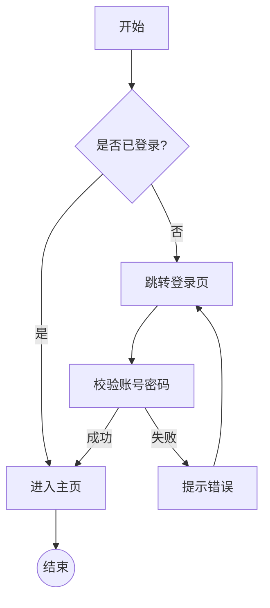
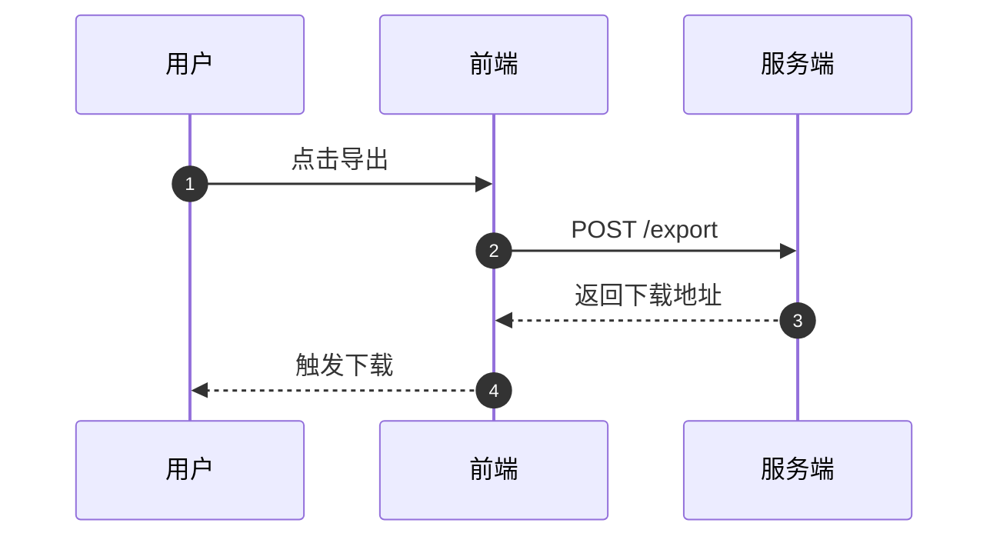
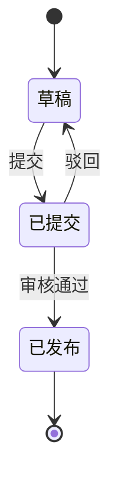
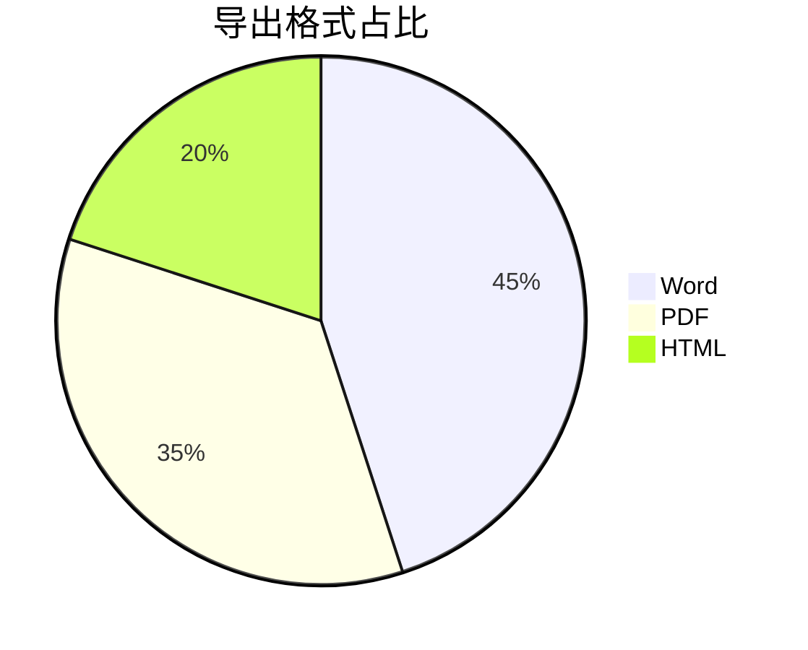
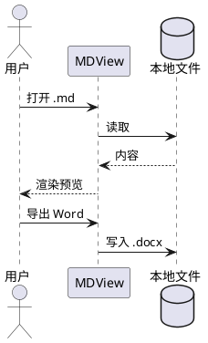

# MDView 功能自测文档

[TOC]

## 1. 基础 Markdown

**粗体**、*斜体*、~~删除线~~、`行内代码`、[外链](https://www.example.com)、H~2~O、x^2^、==高亮==、++下划线++

> 引用块第一行
> 引用块第二行

- 无序项 A
- 无序项 B
  - 嵌套项 B-1
  - 嵌套项 B-2

1. 有序项一
2. 有序项二

- [x] 已完成任务
- [ ] 未完成任务

### 表格

| 左对齐 | 居中 | 右对齐 |
| :--- | :---: | ---: |
| 内容 A | 内容 B | 1234 |
| `code` | **粗** | 5.67 |

### 脚注

这里引用一个脚注[^note]，还有一个[^second]。

[^note]: 第一个脚注的内容。
[^second]: 第二个脚注，包含 `代码`。

### 代码块

```javascript
const greet = (name) => `你好，${name}！`;
console.log(greet('MDView'));
```

```python
def fib(n):
    a, b = 0, 1
    for _ in range(n):
        yield a
        a, b = b, a + b
```

## 2. 数学公式

行内：当 $a \ne 0$ 时，$ax^2+bx+c=0$ 的根为 $x = \frac{-b \pm \sqrt{b^2-4ac}}{2a}$。

块级：

$$
\int_{-\infty}^{\infty} e^{-x^2}\,dx = \sqrt{\pi}
$$

矩阵与分段函数：

$$
A = \begin{pmatrix} a_{11} & a_{12} \\ a_{21} & a_{22} \end{pmatrix},
\qquad
f(x) = \begin{cases}
x^2, & x \ge 0 \\
-x,  & x < 0
\end{cases}
$$

多行对齐：

$$
\begin{aligned}
\nabla \cdot \mathbf{E} &= \frac{\rho}{\varepsilon_0} \\
\nabla \times \mathbf{B} &= \mu_0 \mathbf{J}
\end{aligned}
$$

公式里的中文：$\text{面积} = \pi r^2$

反引号内不解析公式：`$x^2$` 应当原样显示。

行内代码与公式混排：先 `npm run build`，再用 $\sum_{i=1}^{n} i = \frac{n(n+1)}{2}$ 计算。

## 3. Mermaid 图表









### 3.1 思维导图（语言标记直接写 mindmap）

```mindmap
mindmap
    root((MDView 能力))
        编辑
            CodeMirror 6
            快捷键与工具栏
            大纲与滚动同步
        渲染
            Mermaid
            PlantUML
            KaTeX 公式
        导出
            Word
                docx
                公式转图片
            PDF
            HTML
        工程
            Electron
            esbuild 打包
            electron-builder
```

## 4. PlantUML 图表



## 5. 分页与收尾

\pagebreak

这一节位于新的一页（打印 / 导出 PDF 时生效）。

---

*文档结束。*
